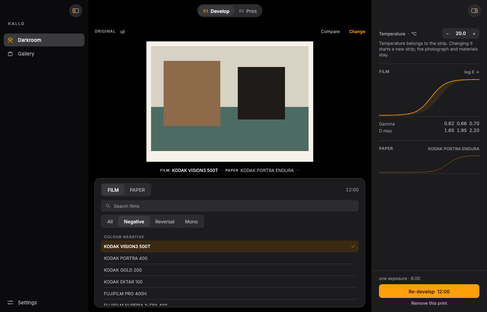
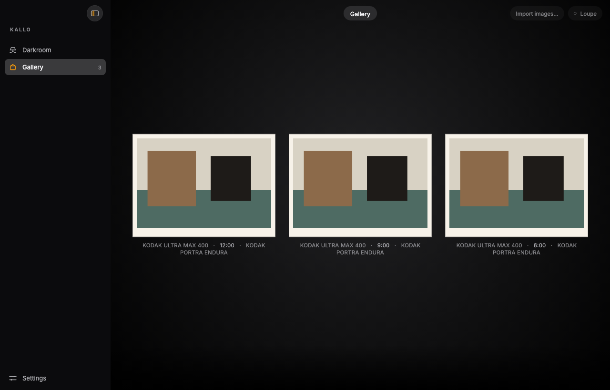

<p align="center">
  
</p>

<h1 align="center">Kallo</h1>

<p align="center">
  A film-simulation darkroom: a physical model of film and print, with an app and a CLI on top.
</p>

<p align="center">
  <a href="https://www.rust-lang.org"></a>
  <a href="https://flutter.dev"></a>
  <a href="https://wgpu.rs"></a>
  <a href="LICENSE"></a>
  <a href="https://github.com/tsukiyo20/kallo/releases/latest"></a>
</p>

<p align="center">
  <a href="README.zh-CN.md">简体中文</a> · <strong>English</strong>
</p>

Kallo takes a photograph and develops it the way a darkroom does: a film, a
development time, a paper, a print. The point is the model underneath — film and
paper are simulated from measured curves and published chemistry, not from a
look-up table — and the app and CLI are two ways to drive it.

## The model

**Light is spectral.** A photograph becomes 71 wavelengths from 380 to 730 nm;
each emulsion layer integrates them against its own measured sensitivity, and
the print reads the paper's reflectance back through CIE into sRGB.

**The numbers are measured.** A film is a data file: characteristic curves,
layer sensitivities, dye absorptions, the orange mask, MTF and grain. All 24
films and 14 papers name the data sheet and page their numbers came from, and no
digitised number lives in code — `kallo-core`'s build script generates the stock
tables from [`data/`](data/README.md).

**Development, grain and interimage are chemistry.** Contrast follows measured
kinetics with a Q10 temperature law; grain is a count of developed grains per
pixel area, so Selwyn granularity falls out of it; halation is light that left
the pixel; and the orange mask is a coupler that dies wherever cyan is formed.


The GPU backend is the same model written in WGSL and checked against the CPU
pixel by pixel, and a stock file is verified by re-deriving every curve from
the points it carries.

## The app

A Flutter darkroom for macOS, Windows, Linux, iOS and Android: put a photograph
on the bench, develop it at a few times, print the one you like, and hang the
prints on a wall.

<p align="center">
  
  
</p>

## The CLI

`kallo` is the model without the window — for scripts, contact proofs and
checking a stock file:

```bash
kallo render photo.jpg -o out.png --film kodak_portra_400 --dev 9
kallo contact photo.jpg -o proof.png --dev 3,6,9,12,15
```

## Install

Prebuilt packages for every platform are in
[Releases](https://github.com/tsukiyo20/kallo/releases/latest).

| Platform | Installer | Portable |
|---|---|---|
| macOS 13+ | `kallo-desktop-macos-universal.dmg` | `.zip` |
| Windows 10/11 x64 | `kallo-desktop-windows-x86_64.msi` | `.zip` |
| Linux x86_64 | `.AppImage` or `.deb` | `.tar.gz` |
| iOS 15+ | `kallo-ios-unsigned.ipa` | — |
| Android 8+ | `kallo-android-universal.apk` | — |
| CLI | `kallo-v0.3.2-<target>.tar.gz` | — |

The desktop builds are unsigned: macOS is ad-hoc signed and not notarized
(right-click → Open the first time), and Windows SmartScreen may ask about the
MSI. The mobile builds are for sideloading; the project has no Apple or Play
signing identity.

## Build

The model needs Rust 1.85+; the app needs Flutter 3.47.9.

```bash
cargo test --workspace --all-features   # the model
cd app
flutter pub get
flutter analyze && flutter test
flutter run -d macos                    # or windows, linux, an iOS/Android device
```

[`app/README.md`](app/README.md) is the interface's rulebook; the data format is
in [`data/README.md`](data/README.md); what a person may adjust, and what stays
locked, is in [`docs/tunable-parameters.md`](docs/tunable-parameters.md). The CLI
runs as `cargo run --release --bin kallo --`.

## Repository

| Path | What it is |
|---|---|
| [`crates/`](crates/) | the model and the `kallo` CLI |
| [`app/`](app/) | the Flutter app; `app/rust/` links the model into it |
| [`data/`](data/) | 24 films and 14 papers, every number traced to a data sheet |
| [`justfile`](justfile) | the local commands CI also runs |

## Licence

GPL-3.0-or-later, see [`LICENSE`](LICENSE). The official builds also carry a
section 7 permission for the App Store, TestFlight and Play, see
[`APPSTORE-EXCEPTION.md`](APPSTORE-EXCEPTION.md). The measurement data is
CC BY-SA 4.0, see [`data/films/LICENSE`](data/films/LICENSE).

## Contributing

Issues and pull requests are welcome; open an issue before a large change.
Contributions are accepted under GPL-3.0-or-later including the App Store
permission. Before opening a PR, run `cargo fmt --all --check`,
`cargo clippy --workspace --all-targets --all-features -- -D warnings`,
`cargo test --workspace --all-features`, and
`cd app && flutter analyze && flutter test`.
