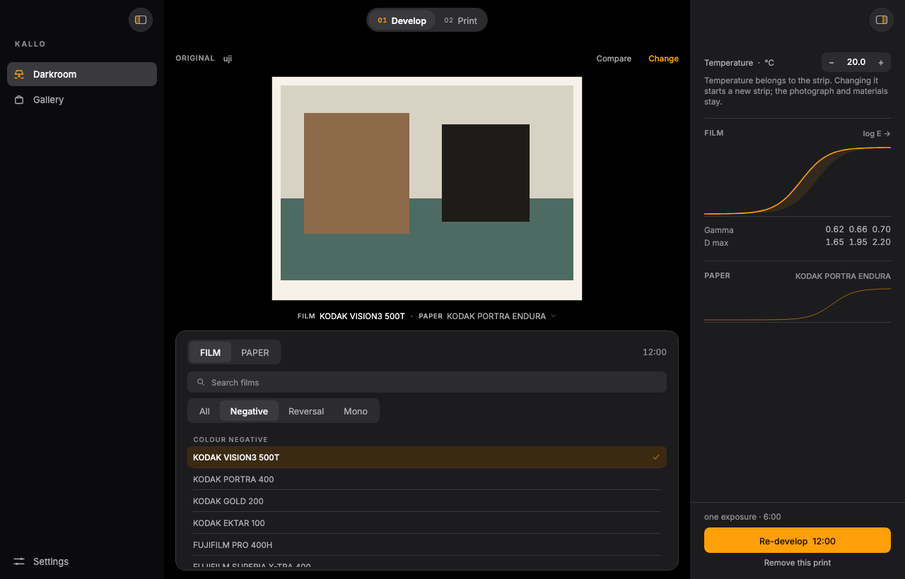
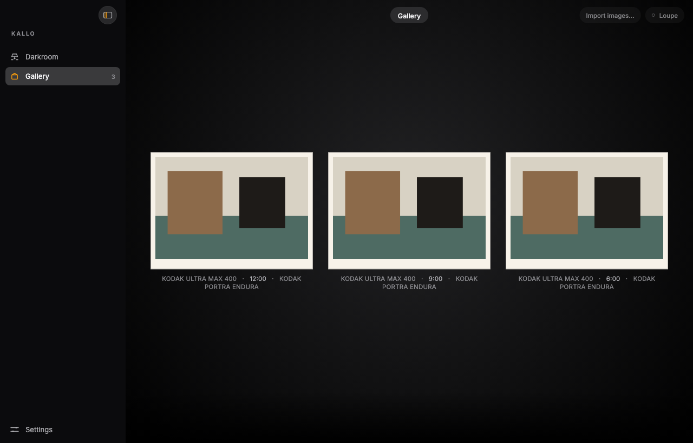

<p align="center">
  
</p>

<h1 align="center">Kallo</h1>

<p align="center">
  一个胶片模拟暗房：胶片与相纸的物理模型，加上一个 App 和一个 CLI。
</p>

<p align="center">
  <a href="https://www.rust-lang.org"></a>
  <a href="https://flutter.dev"></a>
  <a href="https://wgpu.rs"></a>
  <a href="LICENSE"></a>
  <a href="https://github.com/tsukiyo20/kallo/releases/latest"></a>
</p>

<p align="center">
  <strong>简体中文</strong> · <a href="README.md">English</a>
</p>

Kallo 把一张照片按暗房的方式冲洗出来：胶片、显影时间、相纸、照片。真正的重点是下面的模型 —— 胶片和相纸由测得的曲线和公开的化学模型模拟，而不是一张 LUT；App 和 CLI 只是驱动它的两个入口。

## 模型

**光是光谱。** 一张照片被还原成 380–730 nm 的 71 个波长；每一层乳剂用自己的实测感光度积分这些光，相纸再通过 CIE 把反射率读回 sRGB。

**数字是测出来的。** 一种胶片就是一个数据文件：特性曲线、层感光度、染料吸收、橙色 mask、MTF 和颗粒。全部 24 种胶片和 14 种相纸都注明了数据表和页码，程序代码里不保存任何一个测量值 —— `kallo-core` 的构建脚本从 [`data/`](data/README.md) 生成胶片表。

**显影、颗粒和层间效应是化学。** 对比度遵循实测动力学和 Q10 温度律；颗粒按每像素面积内显影颗粒的计数，Selwyn 颗粒度是自然结果；光晕是离开像素的光；橙色 mask 是青色生成处会消失的成色剂。


GPU 后端是同一个模型用 WGSL 写的实现，逐像素对照 CPU 校验；胶片文件会从里面携带的点重新推导每条曲线，不一致就拒绝。

## App

macOS、Windows、Linux、iOS 和 Android 上的 Flutter 暗房：把照片放上工作台，用几个显影时间冲洗，打印你喜欢的那张，再把照片挂到墙上。

<p align="center">
  
  
</p>

## CLI

`kallo` 是没有窗口的模型，供脚本、接触样片和检查胶片文件使用：

```bash
kallo render photo.jpg -o out.png --film kodak_portra_400 --dev 9
kallo contact photo.jpg -o proof.png --dev 3,6,9,12,15
```

## 安装

每个平台的预编译包都在 [Releases](https://github.com/tsukiyo20/kallo/releases/latest)。

| 平台 | 安装包 | 便携版 |
|---|---|---|
| macOS 13+ | `kallo-desktop-macos-universal.dmg` | `.zip` |
| Windows 10/11 x64 | `kallo-desktop-windows-x86_64.msi` | `.zip` |
| Linux x86_64 | `.AppImage` 或 `.deb` | `.tar.gz` |
| iOS 15+ | `kallo-ios-unsigned.ipa` | — |
| Android 8+ | `kallo-android-universal.apk` | — |
| CLI | `kallo-v0.3.2-<target>.tar.gz` | — |

桌面版没有签名：macOS 是 ad-hoc 签名、未公证（第一次右键 → 打开），Windows 的 MSI 可能触发 SmartScreen。移动端用于侧载；项目没有 Apple 或 Play 的签名身份。

## 构建

模型需要 Rust 1.85+；App 需要 Flutter 3.47.9。

```bash
cargo test --workspace --all-features   # 模型
cd app
flutter pub get
flutter analyze && flutter test
flutter run -d macos                    # 或 windows、linux、iOS/Android 设备
```

界面规则在 [`app/README.md`](app/README.md)，数据格式在 [`data/README.md`](data/README.md)。CLI 用 `cargo run --release --bin kallo --` 运行。

## 仓库结构

| 路径 | 是什么 |
|---|---|
| [`crates/`](crates/) | 模型和 `kallo` CLI |
| [`app/`](app/) | Flutter App；`app/rust/` 把模型链接进来 |
| [`data/`](data/) | 24 种胶片和 14 种相纸，每个数字都能追到数据表 |
| [`justfile`](justfile) | CI 也会跑的本地命令 |

## 许可证

GPL-3.0-or-later，见 [`LICENSE`](LICENSE)。官方构建另带一项 GPLv3 第 7 节的附加许可，允许通过 App Store、TestFlight 和 Play 分发，见 [`APPSTORE-EXCEPTION.md`](APPSTORE-EXCEPTION.md)。测量数据是 CC BY-SA 4.0，见 [`data/films/LICENSE`](data/films/LICENSE)。

## 贡献

欢迎 issue 和 PR；大的改动请先开 issue。贡献按 GPL-3.0-or-later 并包含 App Store 附加许可接受。提 PR 前请跑 `cargo fmt --all --check`、`cargo clippy --workspace --all-targets --all-features -- -D warnings`、`cargo test --workspace --all-features`，以及 `cd app && flutter analyze && flutter test`。
