# Kallo
The interface of Kallo.

This is not a widget library and not a design system for other people to use.
It is **this app's vocabulary**, written down once so that every screen after it
is the same product.

It is also small on purpose. If it grows past a few thousand lines it has become
a framework, and a framework is a thing you maintain instead of a thing you
ship.

The phone has its own shell and its own design record:
[`docs/mobile/README.md`](docs/mobile/README.md). The desktop keeps the room
with the two panes; the phone gets one column, two places, two steps and
sheets.

---

## Name and mark

The app, the model, the CLI, the crates and the repository are all **Kallo**.
The window titles, the sidebar wordmark and every platform's display name say
Kallo. The Dart package is `kallo`; the iOS bundle identifier is
`io.github.tsukiyo20.kallo`, and the other platforms still use `com.kallo.app`
because that ID is available to them. The export folder is `Kallo`. The app
has not been published, so these are the first addresses it has, not a
migration away from old ones.

The icon is one 35 mm sprocket edge folded into a K. `icon/kallo-icon.svg` is
the source, `icon/kallo-icon-1024.png` is the rendered master, and
`icon/generate.py` writes every platform's size from it — a rounded square with
a margin for macOS, a full-bleed square for iOS, adaptive layers for Android and
one ICO for Windows.

---

## Run it

Flutter is pinned to **3.47.9** with FVM, and `app/.fvmrc` is the record of it;
CI reads the same number. 3.47 is the first release that renders the desktop
with Impeller and leaves wide gamut on by default on the Mac, so it is a floor
and not a preference.

```bash
brew install fvm    # once
fvm install         # reads .fvmrc
fvm flutter run -d macos
```

Use `fvm flutter`, not `flutter`. A machine can have another SDK on its `PATH`,
and the two render differently — which is exactly the failure this pin exists to
prevent.

All five platforms are checked in: `macos`, `windows`, `linux`, `ios`, `android`.
`KalloLayout.isCompact` chooses the phone shell: a narrow window, a phone, or a
touch tablet. It is one column with two places in the bottom bar, a two-step
segment in the header, and a gear that opens a grouped Settings page. There are
no side panes. The rooms are the same; only the furniture moves. Phones are
portrait-first for now: the vertical deck cannot hold itself in a 390-point-tall
landscape window, and leaving the phone in portrait is better than showing the
desktop's panes there. The landscape workbench is the next phase.
They share one codebase: iOS is `io.github.tsukiyo20.kallo`, the other
platforms are `com.kallo.app`, and the floors are macOS 13, iOS 15, and
Android API 29, which is where Impeller takes the Vulkan path instead of
falling back to its OpenGL ES backend.

The Mac build is **not sandboxed**, and that is a decision rather than an
omission. A sandboxed app's home directory *is* its container, so the export
folder would be somewhere no person can find it, and remembering a folder the
user chose across launches needs security-scoped bookmarks. Until this app is
going to the App Store — the one place the sandbox is not optional — the folder
behaves the way a person expects, and the bookmarks are the price of the day it
does.

There is no `MaterialApp` anywhere, and that is the point.

---

## What is verified

`fvm flutter analyze` is clean, and the suite covers the strip, the two places,
the catalogue, the contact sheet's data, the model's curves, the border
templates printed into a print, both side panes being put away, a test strip
mixing portrait and landscape prints, the gallery loupe's wall and close view,
a phone's print opened whole, the wall being walked and a sheet hung by hand and hung back, a picture brought
onto the wall being shown where it arrived, the shelf's two halves and its
search, the destroy confirm, the About page's open-source note, its changelog row
and the update row's states, the print read against the original with the
wipe, and a camera raw becoming the photograph on the bench. The thirteen
studio goldens are the design's instrument: they pin the bench before a
photograph and with a strip, the shelf on the bench, the wipe, the bench in
daylight, print, the edge picker, the gallery in both appearances and hung by
hand, a portrait print, a print under the loupe and the same print walked up to
at 1280 by 820, with the bundled faces loaded from disk so the picture is in
the product's own type rather than the runner's.

They are opt-in and per platform. A golden is local to the renderer that drew
it, so the baselines live in `test/goldens/<platform>/`: the thirteen committed
today are macOS's, and `test/goldens/windows/` is where a Windows pass draws its
own. The test is skipped unless it is asked for, and it is never a way to turn a
red test green:

```bash
fvm flutter test --dart-define=studio-goldens=true   test/studio_golden_test.dart

fvm flutter test --dart-define=studio-goldens=true --update-goldens   test/studio_golden_test.dart
```

The integration test builds the Debug bundle with its own entrypoint. After it
has run, `fvm flutter build macos --debug` (or `fvm flutter run`) before opening
`Kallo.app` from Finder; otherwise the window is the blank test harness. The raw
photograph path has its own:

```bash
fvm flutter test integration_test/raw_photograph_test.dart -d macos
```

It develops `file-test/DSC03315.ARW` to a 1600-pixel photograph inside the app
it ships in, because the model's decoder is a code asset and `flutter test` does
not carry one.

| | | |
|---|---|---|
| 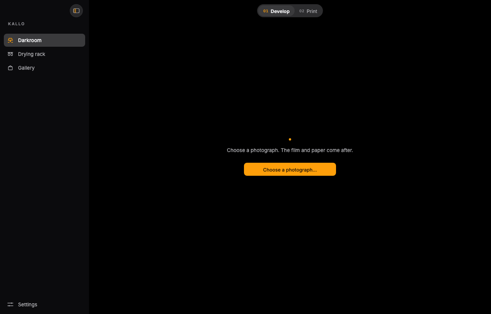 | 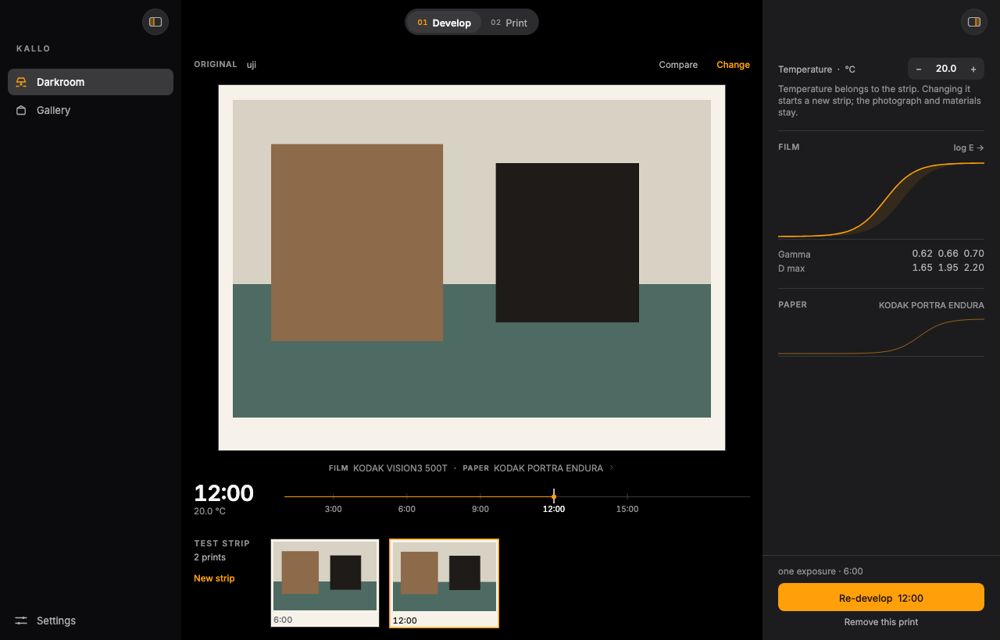 | 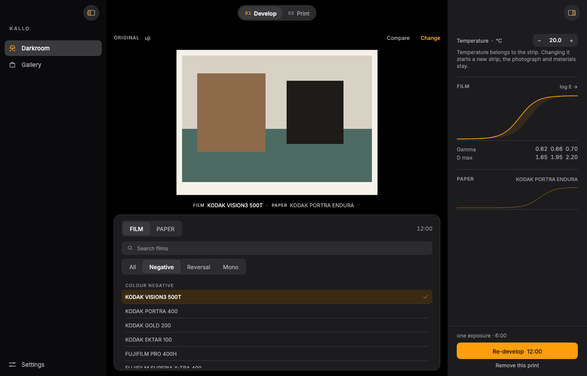 |
| **the bench**, before a photograph | **the bench**, one print at a time, on one exposure | **the shelf**, laid on the bench |
| 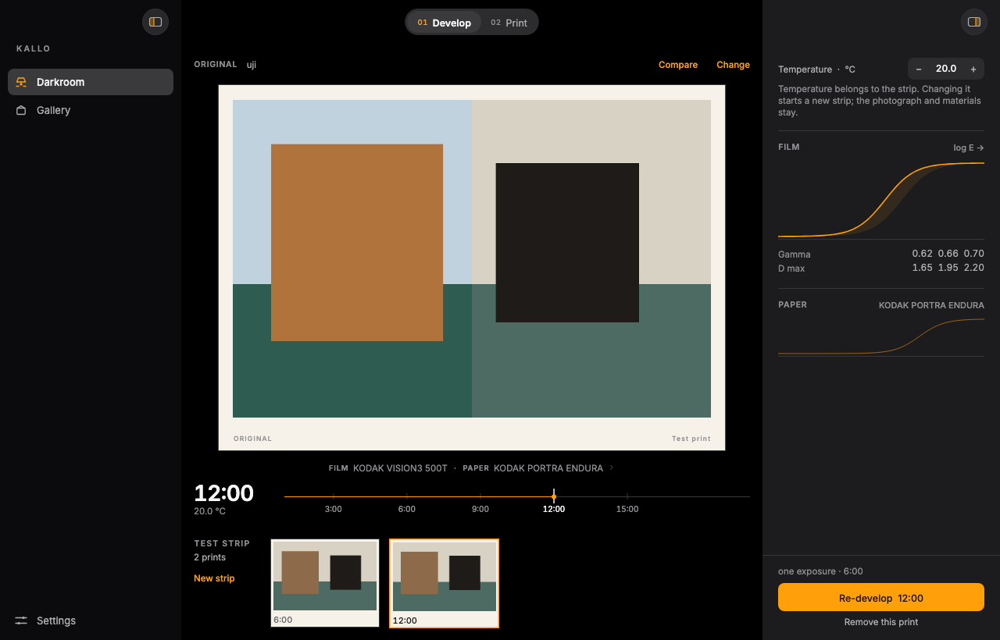 | 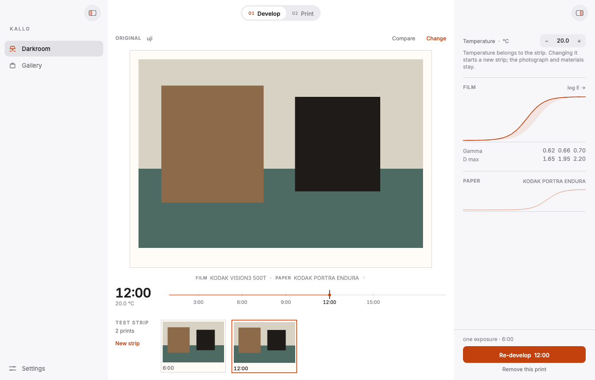 | 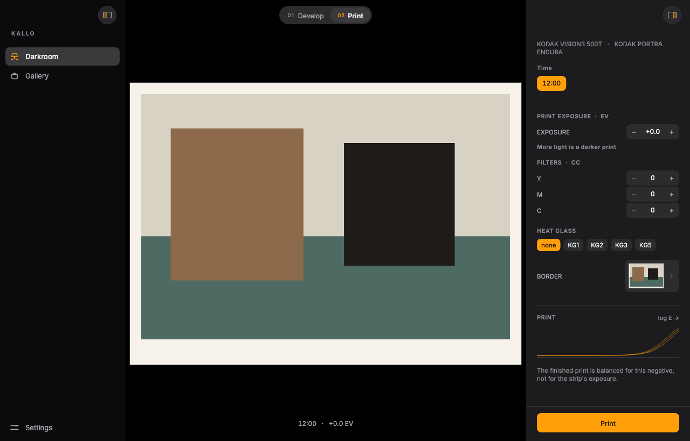 |
| **the wipe**, the print against the original | **the bench, daylight** | **print**, the enlarger dialled for this negative |
| 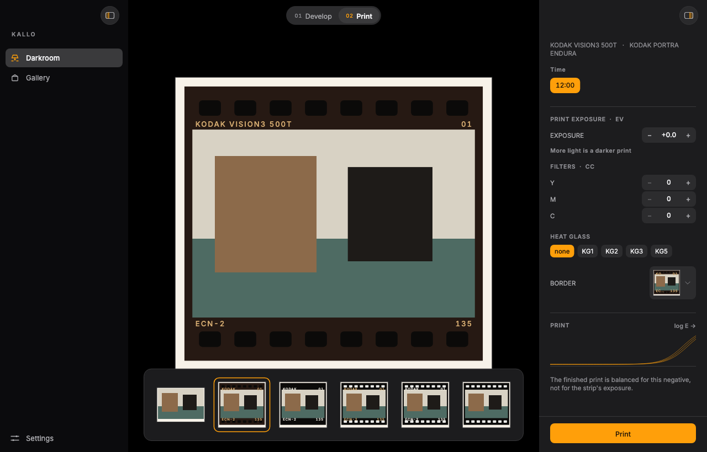 | 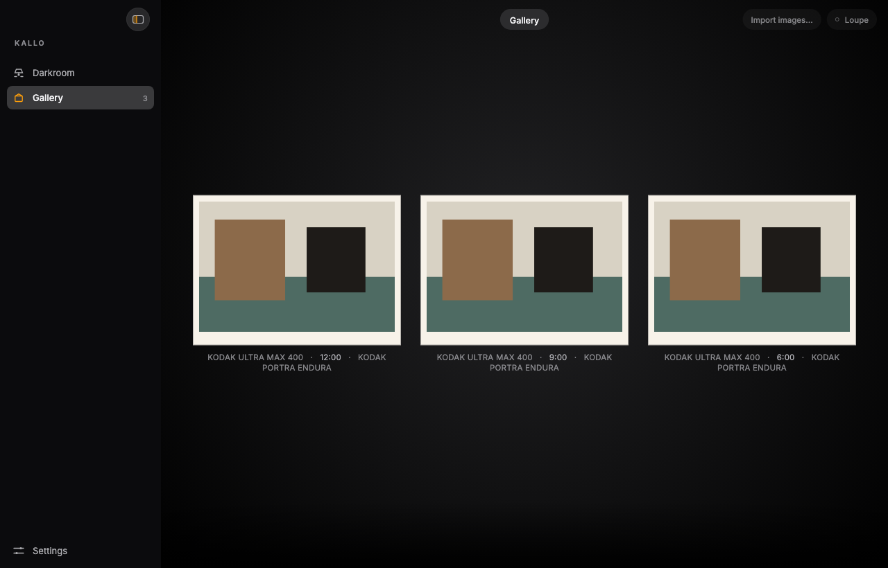 | 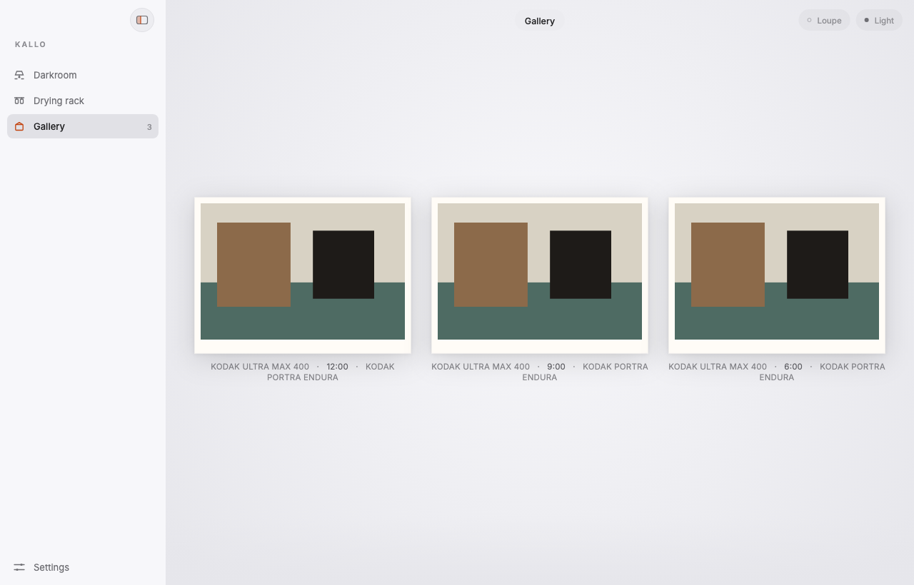 |
| **the edge**, chosen as a picture | **gallery**, prints on the wall, newest first | **gallery, daylight** |
| 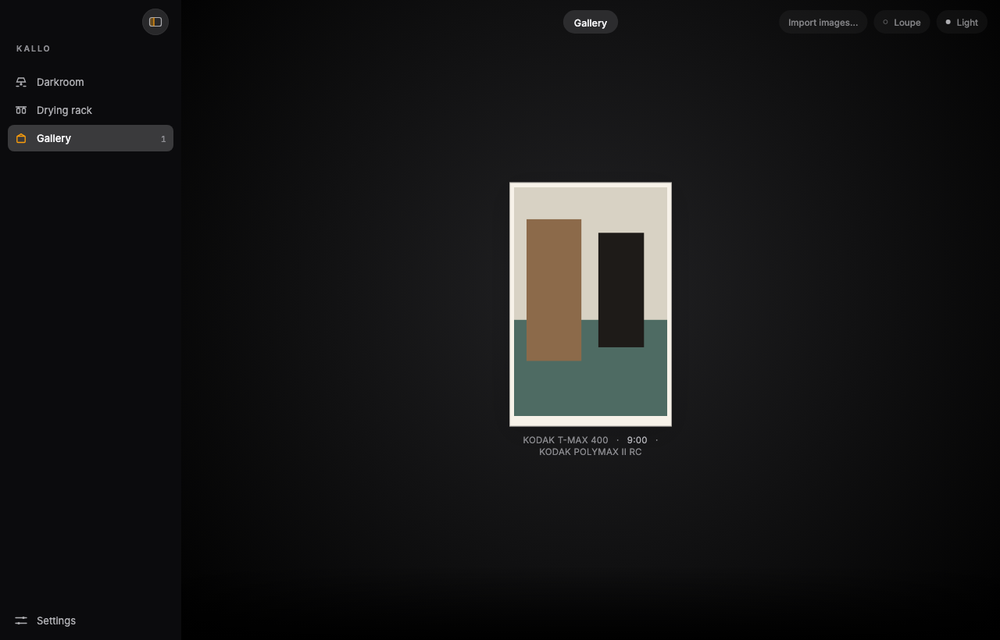 | 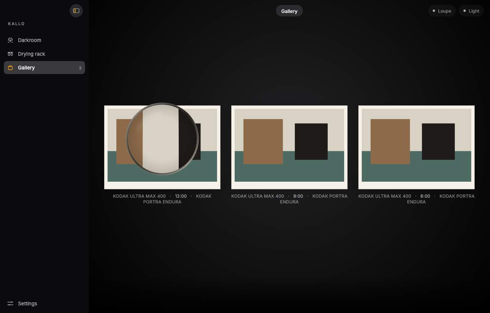 | 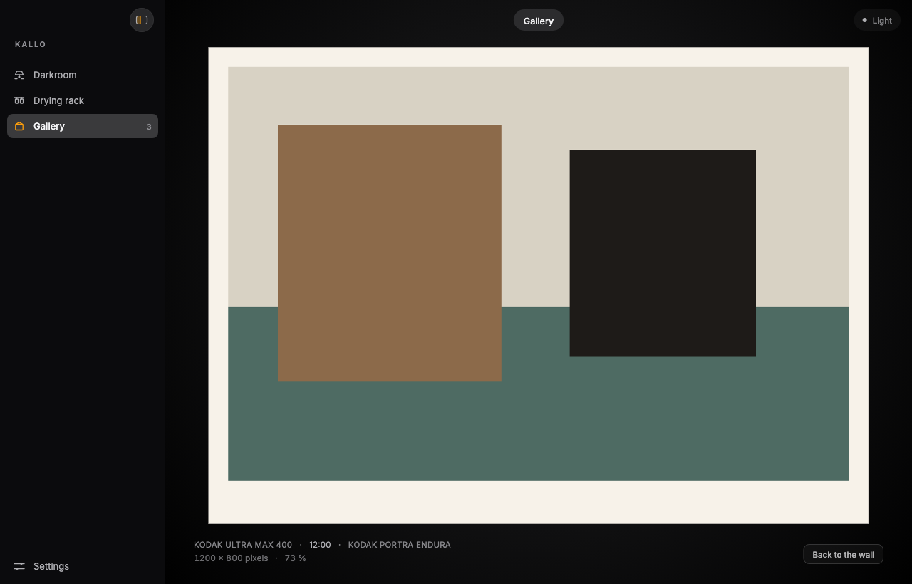 |
| **portrait**, the sheet turned | **lens**, the picture bowed under glass | **loupe**, the print flat, up to 1:1 |
| 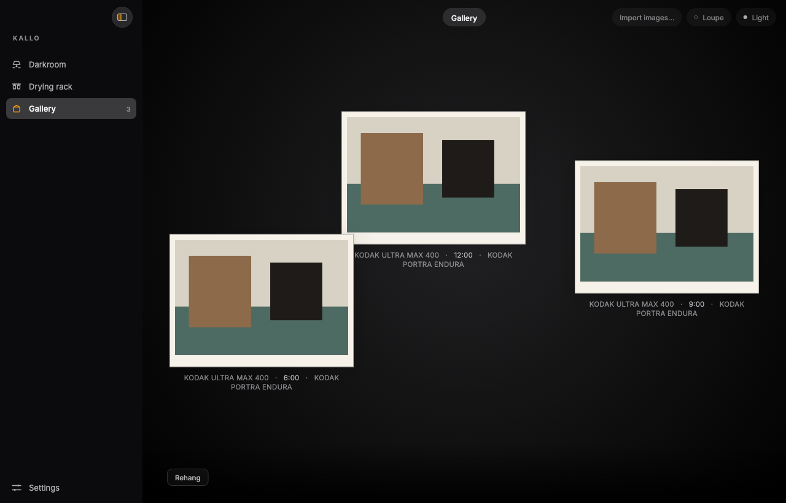 | | |
| **gallery, hung by hand**, work placed where it was put | | |

The gallery and loupe goldens draw a test card, because the app ships no
pictures: a print is a file the model exports, and the golden has to have
something on the wall to be about.

The wall is metadata first. An export is scanned by its header, never decoded
to make a list; the gallery asks for a 512-pixel thumbnail only when a sheet is
built. The thumbnail cache keeps at most 32 MB of decoded paper and writes a
PNG beside the app, and the wall is culled to what is on screen, so a thousand
prints build a screenful of sheets rather than a thousand. On macOS the small
file is made by ImageIO, which never asks the app to hold the 26-megapixel
source; other platforms fall back to the model's image reader and then to the
engine. A synthetic thousand-print library stays around 200 MB with the wall
open in Release, and the first visit to a sheet writes the thumbnail the next
visit reads. Opening one asks the cache for a copy as wide as the paper on
screen (1600 at a small window, in 256-pixel steps up to 4096 at 4K), and the
original file is read only when the print is magnified past 1.5. The preview is
dropped when the viewer closes, and the room underneath is not painted while
the viewer is opaque. A 4K viewer settles around 420 MB rather than the old
600 MB; the remaining weight is the 4K window surface and the viewer's own
layers, not the print. Opening ten prints no longer leaves ten originals
decoded.

The print record has two homes. The file carries it as an XMP packet — a PNG
`iTXt` before `IDAT`, a JPEG APP1 segment — written without decoding or
re-encoding the pixels. The app also keeps a SQLite catalog, `library.sqlite`,
in its support folder. The catalog is what a room reads; the XMP is what makes
the folder portable and what rebuilds the catalog if it is lost. There is no
`prints.json` any more; an old store is read once, each print gets its marker
and row, and the store is renamed to `prints.json.migrated`.

The marker survives a copy, a rename, a move, a backup and a cloud sync. A
program that re-encodes the image may strip it; the catalog then keeps the
print, marks its `xmp_state` as `missing`, and a repair can write the marker
back. A file with no marker that the catalog has never seen is somebody else's
picture and is not hung. Changing the export folder moves only the marked
prints; an import copies a picture into the folder and marks the copy, leaving
the source untouched. The export folder is statted once per file on read, and
the thumbnail key is 64-bit, because a 32-bit key can silently name the wrong
print at this library's future size.

A phone has no folder to choose. iOS keeps the library in the `Kallo` album in
Photos; Android keeps it in `Pictures/Kallo` in MediaStore. The catalog and the
marker are the same; only the locator changes — a `PHAsset` local identifier or
a MediaStore content URI. A phone library therefore reads its list from the
platform, asks PhotoKit or MediaStore for a thumbnail instead of decoding a
file, and imports through the system photo picker. Album membership is the
boundary: an asset whose marker was stripped is still a print, and the catalog
keeps its record.

Android's media permission is asked when a photograph is first chosen, not when
the app opens. Saving a print and the system picker both work without it; what
it buys is seeing pictures another app put in `Pictures/Kallo`, so the app says
that in its own sheet before the system dialog and leaves the picker available
if the answer is no. The Settings page keeps the row that can change the answer,
including the permanent-denial route through system Settings.

A camera-sized print is rendered in horizontal bands when a device caps a single
storage-buffer binding below the frame size — Adreno reports 128 MiB and a 12 MP
frame is 195 MiB. The guard rows are the sum of the vertical effect radii, and a
banded frame is bit-identical to the whole-frame render; the device stays the
one doing the print instead of falling back to the CPU.

The test loads the bundled faces from disk before it draws, so the picture is in
the product's own type rather than the runner's. That is the reason the fonts are
bundled — and both are under the SIL Open Font License, so a public repository
may carry them: `fonts/OFL-Inter.txt`, `fonts/OFL-NotoSansSC.txt`.

GitHub's mark in the About link is from [Simple Icons](https://simpleicons.org)
16 and is CC0 1.0; its source and rendering note live in `assets/README.md`.

The four-plane shell and its twenty-one Windows goldens are gone. What is left
is the window the product opens.
The settings sheet is covered by widget tests rather than a golden: it opens on
About, and neither a drawer title nor the old prose is there.

---

## What you are looking at

One window. The darkroom and the gallery on the left; in the darkroom, two
steps in one small capsule over the centre of the bench: develop, print. The bench is the first step and everything is on it: the original on a
line at its top, the print, the materials under the print, the ruler under that,
and the strip below. There is no bar and no rule under the capsule, because the
steps change what is on the bench, not where the bench is. The bench reserves
the capsule's 56-point band, so a tall print never starts under it. The
instrument panel on the right belongs to the step, and the one action is at its
bottom. Both sides
of the window can be put away. The open sidebar carries its glass switch at the
top right, on the same line as the window's other pane controls; when the
sidebar is put away, the same switch moves into the content's top edge.
The right switch hides the inspector, and the work takes the width back.

Settings is one sheet, opened from the bottom of the sidebar. About is first:
the app's mark, its version, and one click to the repository. There is no
drawer heading and no prose about the type or the model; the other five pages
are the settings themselves, with the one sentence each needs. The rendering
page names the GPU the renderer would open and the CPU behind the fallback, and
the switch under them chooses which engine a render may use. The device is the
default; the processor is a choice, and a render the device rejects still
finishes on the CPU on its own.

On a phone the same work is not a small window. The bottom bar holds the three
places and nothing else; the header holds the two steps; the gear opens one
grouped Settings page with Done. The darkroom opens on the bench: the test print
on paper, the materials on one line under it — the film, the paper and the
photograph in one sheet — the test strip, the clock and the ruler in one deck.
Print is four summary cells and one action. The gallery is the same walkable
wall as the desktop, walked by drag and pinch, and its import action is the
header's. A print opens whole when it is tapped: the wall is the index, and the
picture gets a page of its own, the width of the screen. The curves move to a
Details sheet. The phone does not use the desktop panes at all, and the desktop
does not use the phone's.

| | |
|---|---|
| **The bench is the first step, and the materials are on it** | One photograph enters the darkroom and the bench shows what it becomes; the original is a line at the top of the bench — its name and *Change* — not a page before the developer. A photograph can be a camera raw: the window's decoder reads what a window reads, so the model develops the mosaic into the picture on the bench — the photograph the print will be made from, not a camera's preview with a look baked in. The film and the paper are under the print as two handles, `胶片` and `相纸`: each opens the shelf on its own half, as a card lying on the bench, and the print answers every tap. The card is a drawer, not a wall of chips: a search field, the chemistry filters, and rows grouped by chemistry on both halves, with the maker in the name on every row — no second taxonomy inside a half of six or twenty-four — and the chosen box a check mark on its row, and the card opening on the chosen row rather than at the top of a shelf nobody has walked. The materials are not constants in the app: `kalo stocks --json` hands over every film the model carries, grouped by chemistry and then by manufacturer, and every paper under a rule of its own, so the shelf cannot show a film or a paper the model does not have. The maker is part of the name (`KODAK PORTRA 400`), not a heading inside a heading: chemistry is the only taxonomy a half carries, and a second list of makes was exactly the wall of chips the drawer replaced. Another box starts a new strip; with prints on the strip the bench asks first. The bench gives the work the pane, not a column inside it: the sheet is sized by whichever of the pane's width and height runs out first, so a landscape print reaches the side panels and a portrait one is as tall as the room allows. |
| **The develop step is one print at a time** | The print on the easel is the time in hand; the ruler under it moves the time; the strip below it is what has been printed. Dragging the ruler only changes the preview. Pressing *develop* renders one print at 1200 px and adds it to the strip. The first print fixes the enlarger's exposure, and every later print keeps it — the strip compares developments, not timers. The temperature is a dial in the panel; it belongs to the strip, so changing it starts a new strip and keeps the photograph and materials. The panel draws the film's developed curve, the paper's, the strip's times together, and the densitometer's gamma and D-max. The print can be read against the original: *Compare* lays the original behind the print and the pointer moves the seam; there is no divider, and the edge between the two pictures is the whole control. The paper's bottom margin names the two sides — `ORIGINAL` and `Test print` — so no ink touches the picture. Pressing *develop* turns the button into the work's progress: the accent fills from the window's grey while the model works, and the last frame of the bar is the button again. The fill is the model's: the decode, the resize, the render's own stages — the device's passes and bands, or the CPU's exposure, blur, halation and development — and the rows of the PNG are each reported as they land, so the bar moves because the work moved. A model that cannot report its stages (the subprocess used in development) falls back to the last develop's clock. |
| **The print step is the enlarger dialled** | The chosen development is printed again at the photograph's size, balanced on its own negative, with the timer, the CC pack and the heat glass. It is not a copy of the strip's print: the strip is one exposure; the finished print is the one dialled for this photograph. The panel draws the paper's curve under those settings — the timer, the pack and the glass move it — so the picture and the instrument are the same enlarger. Pressing *print* opens a sheet for the size (original, 6000 or 4000 pixels) and the file format (PNG or JPEG). The button is the progress there too. Each print is a file named after the photograph and an eight-character fingerprint of the recipe — stock, paper, development, exposure, pack, glass, edge, size — so a second edge of the same negative is a second sheet in the folder, while asking for the same print twice still replaces itself. |
| **The path is a choice** | Exposure, print and scan go through the spectrum — 71 wavelengths, reconstructed from the input and integrated against each layer's sensitivity — or through one number per channel. It is a setting because the model keeps it opt-in: the structure is physical end to end, and the data under it is mixed — the curves and layer sensitivities of twenty-one films are measured, the papers are, the illuminant is CIE D50, and fifteen films still borrow their dye shapes because their sheets print a neutral instead of three dyes. The shelf card and the catalogue say per film which is which. The two paths are different photographs, not different labels, and the strip remembers which made it: a print of that strip is made the same way. |
| **The model is the app's own library** | The app's Dart package (`kallo`) links `kallo-api` through `flutter_rust_bridge`; a strip print is one call, and a finished print is the same pipeline at the photograph's size. A roll and its contact proof are one call for the CLI, from one read of the photograph. The `kalo` binary is still underneath as the fallback when the library cannot load — tests run that way — and both answer the same `Model`, because the binding was written to the shape the subprocess already had. |
| **The app says what it is** | Settings › About is the mark, the version, and the three sentences the page exists for: Kallo is entirely open source and free under the MIT or Apache-2.0 licence, the model and the interface both live on GitHub, issues and pull requests are welcome, and a star is the best thanks. The GitHub card and a `更新日志` row open the repository and its Releases page, and an update row asks GitHub for `releases/latest` — the newest release, never a prerelease, and the only release this app offers — then, on macOS or Windows, downloads the release asset and replaces its own installation before restarting. The release workflow publishes the macOS app and the Windows app beside the CLI, under the asset names the updater looks for, so the row has something to find. |
| **Two places, two steps** | The darkroom and the gallery. In the darkroom: develop and print — the strip and the finished print, with the photograph and its materials on the same bench. The gallery has no steps: a wall is looked at, not operated. There used to be a drying rack between them, and it is gone: it held the same files the wall holds, with a second viewer over them, and a third place that repeats the second is not a place. When a print is done, the print step says so and offers the wall. |
| **The wall is longer than the window** | The gallery used to be a grid inside one window, as if the room ended at the edge of the screen, and the arrangement was the app's: a grid says nothing about the pictures, and five developments of one negative are five equal things. That is still the wall's default. The wall is a place a person walks now: drag the empty wall to walk it, wheel or pinch to step back, and the wall hangs its work in that same grid until the first sheet is moved — then the whole hanging freezes and the wall is theirs. A sheet dragged anywhere stays there, labels and all, and the sheet under the pointer is the one in hand; new work is hung in a fresh line beneath what is already there, and *Rehang* puts the wall back in its grid. The hanging is the wall's, not the print's: the catalog keeps it under the library, and it is not written into the XMP marker. The import action is the wall's own, at the top right of the chrome (on a phone, the header), and it is no longer a row in the settings page about where prints go. |
| **The test strip is the proof, made one print at a time** | A proof is the film laid on paper and exposed once. The strip is that idea with the person's hand in it: one print per development, all on the first print's exposure, laid side by side. Each print is scaled to the strip's height and takes the width its own shape asks for, so a portrait and a landscape print sit on the same strip without being cropped or overflowing. A longer development makes a denser negative, so on one exposure it prints lighter; the strip says that before the finished print is dialled. The prints are rendered, not drawn: each is a real 1200 px print, and the densitometer reads its chart. |
| **A print can be looked through, then walked up to** | The loupe is a switch on the wall's chrome, put away by default. With it out, hovering a print brings a loupe to the pointer: three times the wall, from the print's own file decoded wide enough to be sharp. The picture under the lens bows slightly at its edge — glass is not a window — while the paper stays flat. The switch belongs to the wall, so it goes when a print fills the window. Clicking opens the print at the file's own size: the sheet keeps its size and shape — this is a loupe on paper, not a picture viewer — and the picture is magnified *inside* its margin, clipped by the paper, up to 1:1, one image pixel per device pixel, which is as far as the file goes. That close view is flat: it moves the picture under the paper and never bends the file. The label under it says the file's pixels and the scale, and escape puts it back on the wall. A phone does not have the room for this view: there a tap opens the print whole. |
| **The gallery is a wall of paper** | A print is not a picture; it is a sheet of paper reflecting whatever light falls on it. The wall and its labels are that light, and they follow the window: a wall in daylight in a light appearance, a wall after dark in a dark one. The light is the room's, not a switch in the chrome — the app has no lamp to turn off. Each print is a sheet: paper, a margin and a shadow, with the stock, the development time and the paper on the label under it. The stock says its manufacturer (`KODAK ULTRA MAX 400`, `ILFORD DELTA 400`) and the caption under the sheet does too. A single print is `01`; a batch of selected frames will count `02`, `03`. Sheets are given the same area, so a portrait is the same sheet turned, not a bigger one. The film's rebate is not on this wall: a print is cropped to the frame, and the black edge a darkroom can print belongs to the printing stage. |
| **A phone opens a print whole** | A phone's wall has room for a sheet, not for the photograph, so it is an index. Tapping a print pushes a page of its own: the picture on black, fitted the way a photo viewer fits one — the whole width of the screen, and the margin that is left goes above and below, never beside. It is not the paper's close view, and the wall is not rebuilt to make room for it: the page sits over the gallery's chrome, so going back finds the header, the tab bar and the hanging exactly where they were. One row at the top, clear of the system's own bars, is the way back and what the file is — stock, development, paper, the file's pixels and the scale. Pinch and double tap walk up to one image pixel per device pixel; the system's back leaves the picture, and the next one leaves the wall. |
| **A print is a file, not an asset** | The app ships no pictures. `just print <photograph>` renders one through the model into the export folder, and the gallery hangs the marked prints in there — nothing, most of the time, which is why an empty wall is a state and not a bug. The folder is a setting on desktop; a phone keeps its prints in the `Kallo` album in Photos or in `Pictures/Kallo` in MediaStore. The print sheet is size, then format. The border is not asked for there: it is chosen on the bench, where `边框` is one row with a small print of the current edge in it — no names. Press it and a card lies on the bench with the edges as six pictures: `无`, `留边·暖` (a colour negative with its orange mask kept: brown rebate, black perforations, amber letters), `留边·中性` (a negative's paper print: black rebate, no visible perforations, paper-white letters), and the reversal on a light box as `留边·白孔·琥珀字`, `留边·白孔·白字` (black dye, white perforations, clear letters) and `留边·白孔·无字` (the same edge with no edge printing). A tap takes one, another tap takes it away, and the bench previews it live; the row shrinks its proofs to show all of them and a mouse wheel over it turns it sideways when there are more than fit. The edge is baked into the one print when it is written; there is no second file and no `Frames/` folder. The record — stock, paper, development, print number, title, dates — is an XMP packet inside the print, not a sidecar; the SQLite catalog indexes it for the rooms. Import copies a picture into the library and marks the copy; the source is never modified. |
| **The chrome is a neutral, the print is paper** | The window is a tool, so its planes are one Apple-shaped neutral ramp in both appearances: grouped background, sidebar, content, inspector, a recessed fill for every control, and the safelight only where something is chosen or acted on. Corners are 8, 14 and 20; hairlines are quiet. The only warm and saturated surfaces in the product are the paper a print sits on and the gallery wall behind it. |
| **Time is a ruler** | The develop step's ruler is continuous and the model accepts any positive time; 3/6/9/12/15 are the marks, not a limit. The strip's prints are the times actually tried, and the panel draws their curves together. The point is the difference between them. |
| **Nothing is a default** | No ripple, no elevation, no Roboto, no colour roles, no 4 dp grid. |

---

## The rules

These are the ones worth enforcing in review.

1. **No `MaterialApp`. No `Material`, `Card`, `Elevation`, `InkWell`.**
   `WidgetsApp` gives text direction, focus, overlay, semantics and routing.
   It gives nothing else. `uses-material-design: false` in `pubspec.yaml` is
   where that is written down.

2. **No shadows for layout.** A plane is raised by being lighter than what is
   behind it, and by a fill. A shadow belongs to an object in the room: the
   sheet over the window, the print hung on the wall, the viewer's paper. It
   does not say a card is deep.

3. **One accent.** The safelight: a selection, the tone curve, and the one
   primary action on a page. Everything else is a neutral on one luminance
   ramp, because the contrast in this product is density — which is brightness
   — and not hue. The gallery's wall and the paper are the exception
   that proves it: they are not state, they are objects.

4. **The ramps are closed sets.** Seven spacing steps, three radii and one
   capsule, eight type roles. When you need a new one, the layout is usually
   wrong. The gaps in `KalloSpace` are the whole reason it reads as deliberate.

5. **A hairline is one device pixel, not one logical pixel.** *Not met yet*: the
   hairlines are `BorderSide`s of width 1, which is two device pixels on a
   Retina screen. The rule stands; the code has to catch up.

6. **Nothing animates alone.** `KalloMotion.stagger` is 40 ms. If three things
   move, they move 40 ms apart. The room's light is one number and one tween, so
   that when it changes, everything changes together.

7. **Nothing on screen is invented here.** No curve, no density and no grain is
   derived in Dart; `assets/film_strip.json` is written by `just view` from the
   model and is a rendering of it at a commit. The one thing the app decides is
   *light* — a multiplication — and that is stated where it happens
   (`KalloColors.under`).

---

## Tokens

`lib/design/tokens.dart` is the whole visual contract.

- **Colours** — two complete sets, `light` and `dark`, resolved once from the
  system unless the user pinned one. Four planes (`ground`, `sidebar`, `content`,
  `surface`) and a three-step control ramp (`fill`, `fillStrong`, `elevated`), one
  `hairline`, three inks, the `accent` and its `accentSoft` wash, `onAccent`, the
  modal `scrim`, and `print`: the paper. Plus one operation — `under(colour,
  light)` — because a wall under a lamp is the same wall lit less, and a print is
  a reflectance, not an image with an opacity.
- **The wall** — `KalloWall`: the ground, the paper, the label and the control
  colours of the one room in the product that is lit by a lamp, in both
  appearances, plus the largest a print gets on it and how much light an eye
  keeps in the dark. A wall is lit by the room it stands in, so it follows the
  window's appearance; the light is the room's, and the chrome does not switch it.
The gallery is a wall that runs past the window: it opens on its beginning, and
a drag walks it, a click hangs up a sheet, and the two quiet words at the bottom
put it back where it was or back in its grid. The import action is at the top
right of the wall's chrome; the settings page still says where the files go.
- **The viewer** — the desktop's close view has no palette of its own: it
  borrows the wall's ground and the window's ink, because it is still in the room
  the print came from. A phone's viewer is the one exception the product allows:
  a black page with the photograph on it, and one row of ink above it.
- **Ink on paper** — `KalloInk`: what a contact proof writes on its sheet, at
  the light set's values in both appearances, because the paper does not turn
  dark when the window does. The accent is the safelight's, for the mark around
  the frame that was chosen.
- **The print's edge** — `KalloFilm`: the black rebate, the masked rebate a
  colour negative keeps (brown) and the edge printing (paper white, amber on
  the warm template, white on the light box). A template is a reading of the
  edge, and the painter draws the one chosen. It is an object in the work, like the paper, and it is lit by
  the same lamp; the wall never shows it.
- **Space** — 2, 4, 8, 12, 16, 24, 32.
- **Radius** — 8 for a control, 14 for a card, 20 for a sheet, and a capsule
  for a tab track or a toolbar control.
- **Shadow** — one baked sheet over the window and one baked paper hanging in
  air; a chosen segment is a fill and a hairline. No layout shadow, and no blur
  pass for a shadow.
- **Motion** — 90 / 160 / 240 / 460 ms, three curves, one stagger. A control
  answers faster than a room changes: the one is a switch, the other is the eye.
- **Type** — Inter, with Noto Sans SC behind it for Chinese. Eight roles:
  `plate`, `display`, `title`, `body`, `small`, `caption` (spaced caps),
  `data` and `folio` (tabular, so that a number changing does not move the
  things around it).

The English build is the Chinese build with fewer words in it, so switching
language moves no layout. `lib/design/strings.dart` holds every label; the
film's own vocabulary — `EI`, `C-41`, a stock name, a temperature — never
translates.

---

## What is deliberately not here

- **The model.** The nine densities on every frame are read from
  `assets/film_strip.json`, written by `just view` from `kallo-view`. The
  roll is VISION3 500T developed five times, not a shape invented to look like
  one. Regenerate it; never edit it.
- **A developed roll's chart is the film's, not the picture's.** The library
  reads the stock's nine-step wedge at each development the way a densitometer
  reads a strip: through the base, the fog and the orange mask, so the numbers
  are a reading and not the curve redrawn. A roll the app developed carries a
  measured chart; the committed strip is the model's drawing — charted, not
  measured. The subprocess fallback writes pixels and no densities, and a roll
  developed that way stays chartless — which is what `flutter test` sees.
- **A settings card with nothing to set.** The drawer is six pages: about,
  language, appearance, the print folder, the path and the renderer. The first
  is the app itself — its mark, its version and one way out to the repository;
  the renderer page is the one card that names hardware, and it does so because
  the app can switch it. A card about a renderer the app cannot switch, or a
  sound it does not make, was the scaffold's idea of a settings page; it is not
  this one. The version is the bundle's, mirrored once in `app_info.dart` and
  checked against `pubspec.yaml` by a test, not copied into the interface ad
  hoc.
- **A soft proof of the paper's surface.** A print is rendered again from the
  photograph, at the size the photograph has and capped at 6000 points, and the
  app's own record carries the stock, the paper and the development rather than
  a sidecar beside the picture. What the app can show before that is the
  presentation: the bench shows the paper
  the way the wall will, and the table is the model's own contact proof. What
  it cannot show is the paper itself — the model exports pixels, not a
  reflectance, so the surface, the sheen, and the difference between Crystal
  Archive and Endura are not simulated, and the sheet is one paper colour in
  both rooms.
- **A print from a reversal.** A reversal is developed to a positive and
  scanned: there is no print stage between the film and the picture. The bench
  says so where the button would be rather than making a print that is a second
  scan of the same slide.
- **A silver paper for a colour film.** The shelf does not offer one. The model's
  print is three channels and a silver paper has one record, so a colour film on
  a silver paper would render colour — `polymax_ii_rc` says in its own note that
  the format cannot express a paper that is one record. The shelf offers what the
  model can actually do, and a paper that rendered colour would be a lie about
  the paper.
- **A paper for a film with no print stage.** A reversal has no paper to choose:
  there is no print. The shelf says so where the papers would be.
- **A folder chooser on a phone.** iOS gives the app one album in Photos;
  Android gives it `Pictures/Kallo` in MediaStore. A folder picker there is a
  desktop idiom, so the drawer names the system location instead of offering a
  button that would do nothing.
- **Colour management.** The model writes sRGB and the system manages the
  display. Wide gamut is the screen's business; nothing here is tagged or
  converted.
- **Text input.** `EditableText`, selection, IME and accessibility are the
  framework's job. Do not rebuild them; rebuild everything you can see.

---

## How to judge it

Screenshot a place, remove the text, and look at it.

If it still reads as *this* product, the language is working. If it reads as a
Flutter app, the problem is in one of the seven rules above — not in a library.
